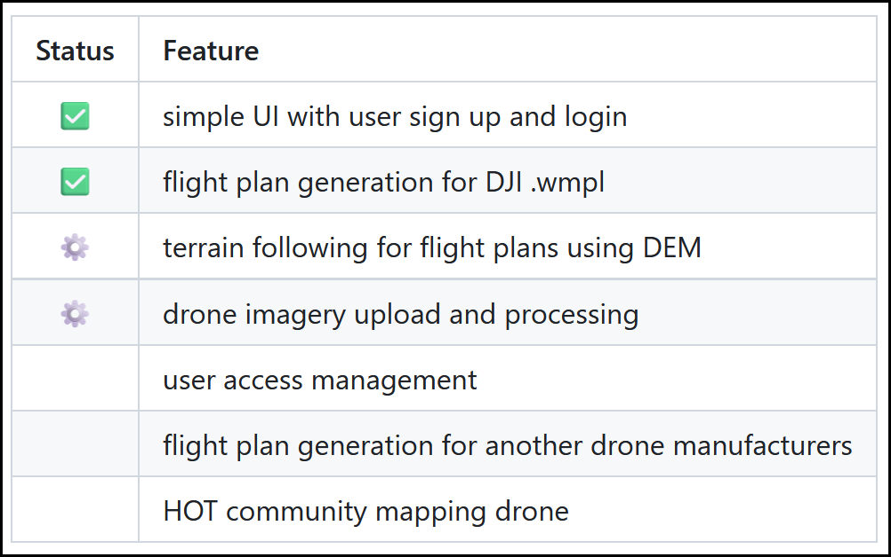

# HOT's Development Practices

This was last updated on 24/11/2026 and details how we build software.

It applies to everyone writing code for our tools: HOT staff, contractors,
and volunteers. Please read it before starting, and ask if anything is unclear.

Devs new to HOT can start at [Defining How We Build](#defining-how-we-build).

## Summary

- We work in the open, and design features together with the devs building
  them.
- Bigger decisions are written down and agreed **before** code is written.
- AI tools are fine to use, but **you own every line** you submit.
- Every PR is reviewed by at least one human dev before merge.
- Show it works: tests in CI, plus a demo and walkthrough of what was built.

## Open-Source Model

- All code developed at HOT is open-source.
  - We rely heavily on community feedback to steer our development.
  - Contribution from **anyone** is welcome.
- We follow a fork-and-PR model:
  - Developers should create a fork of the repo they wish to modify.
  - Code is added to a branch inside **the fork**.
  - A pull request (merge request or PR) is made against the development
    branch of the original repository.
- Our code is generally licensed
  [AGPLv3](https://www.gnu.org/licenses/agpl-3.0.en.html)
  unless otherwise specified.

!!! note

    Some tools still use BSD-2-Clause:
    - Tasking Manager
    - Export Tool
    - Open Aerial Map

    [More details here](./dev-guide/repo-management/licensing.md)

## Defining **What** We Build

### Gathering Requirements

#### Translating User Requirements Into Actions

- Our main feedback mechanism is through user testing. This should be done in
  collaboration with our hubs and partners to determine: what works well, and what
  doesn't. The general public will also use our tools and provide feedback.
- For field-based tools (FieldTM, DroneTM), this would involve running mapping campaigns
  and gathering feedback from the teams involved.
- For desk-based tools (everything else), we mostly gather feedback through
  [user requests](#user-requests) and Slack.
- All tools have a public channel on Slack for discussion, providing feedback, and
  gathering requirements.
- Once we have gathered feedback, this should be divided up into actionable Git
  issues by the PO / Tech Lead and grouped into projects or releases.

  > See the [project management](#project-management) and [releases](#releases)
  > sections for details about grouping tasks into themes.

#### User Requests

- Anyone can submit a request via
  [roadmap.hotosm.org](https://roadmap.hotosm.org/#tech-request), either as a
  Github issue, or as a structured email.
- This covers tool issues, feature requests, data access, data problems, etc.
- Each request is reviewed by a member of the tech team, then addressed directly,
  or added to the relevant Github repo and roadmap.

#### Gathering Direct Technical Feedback

- Users that are more tech-focused can create issues directly on our Git project.
- Discussions can also be used on our Git tracker for more general user input or
  feedback.
- Most often this will be bug reports, which should generally be high priority for
  the next release (or a [hotfix](#hotfixes) to production if `critical` priority).
- The PO / Tech Lead should triage tasks, assign priorities, and group into projects
  or releases.

  > See the [issue labels section](#issue-tags) for details about priority assignment.

#### Co-Designing With Developers

- When working with external developers, we don't provide a detailed spec and then
  wait for a deliverable.
- Product, UI/UX, and architecture decisions are made **together** with the devs
  building them, whether staff, contractors, or volunteers.
- This takes pressure off getting everything right up front (agile), and makes the
  best use of everyone's experience.

### Setting Priorities

- Generally bugs will take priority over new features, particularly those blocking
  the user's workflow.
- Projects for a tool will be assessed based on internal team discussion, in
  addition to public Slack and Git-based discussion.
- The determined priorities and projects will be a tradeoff between:
  - Original vision and goals of the tool.
  - Most prominent user requests.
  - Global events and crisis response (activations).
  - Requirements from actively engaged stakeholders / organization.

### Keeping Users Updated

Users can keep informed about ongoing tasks in various ways:

- Public announcements on [Slack](https://slack.hotosm.org) / blog posts on HOT's
  website, OSM Diaries, Dev.to, or other platforms.
- Releases on Github and included release notes.
- The [user roadmap](#user-roadmap) tracking progress for each repo.
- The overarching [public roadmap](#public-roadmap), showing planned work across
  all tools.
- Any [discussions](#discussions) around particular features that have not been agreed
  upon and translated into an issue / project.

### Questions / Clarification

- HOT works fully in the open. If anything is unclear (the vision for a tool,
  planned features, how we work, timelines), please ask:
  - On our public [Slack](https://slack.hotosm.org), in a tool's channel, or as a
  private message to a member of the tech team.
  <!-- markdownlint-disable -->
  - Via Github [issues](#issues-features) or [discussions](#discussions).
  <!-- markdownlint-enable -->
  - By message or email to the Product Owner or Tech Lead of the tool.
  - In the monthly 'Open Tech and Innovation Space' calls advertised on Slack.

## Defining **How** We Build

### Design Before Code

- Bigger decisions should be written up as a Markdown Architectural Decision
  Record (MADR), and agreed **before** coding starts.
- Write one when a decision:
  - Affects more than one part of the code, or the public API.
  - Had real alternatives that were rejected.
  - Couldn't be understood later from the code or git history alone.
- Decisions already agreed in meetings can stay in the meeting notes.
- Small choices with no real alternative are conventions, and can go in the
  repo README or CONTRIBUTING instead.

#### Writing A MADR

- Add it to `docs/decisions/` in the repo via a PR, numbered in order:
  `0001-short-title.md`, `0002-short-title.md`, etc.
- Keep it short, with these sections:
  - **Context**: the problem, and why it needs a decision now.
  - **Options Considered**: the real alternatives, and why they lost.
  - **Decision**: what we chose, stated plainly.
  - **Consequences**: the good and the bad, including costs we accept.
- The status is `Proposed` while the PR is open, and `Accepted` once merged.
- Accepted MADRs are not rewritten, see
  [replacing a decision](./decisions/README.md#replacing-a-decision).
- Examples: our own [Tech Decisions](./decisions/README.md), or
  [Drone-TM](https://github.com/hotosm/drone-tm/tree/main/docs/decisions).

### Using AI Tools

- Everyone must read and follow the
  [Responsible AI Guide](https://responsibleai.guide), in particular the
  [AI-Assisted Coding Guide](https://responsibleai.guide/ai-assisted-coding-guide).
- AI coding assistants are fine to use, but your work should include meaningful human
  effort and judgement:
  - Work should be AI-assisted, never AI-driven. Don't let autonomous agents
    write code or open PRs without you directing and checking each change.
  - You own every line you submit, and should be able to explain any of it.
  - Say in the PR description where AI was used.
  - Write PR descriptions and comments yourself, don't paste LLM output.
  - Never put secrets, user data, or partner data into AI tools.
- PRs or comments that look automated or low effort will be closed, and
  accounts that repeatedly submit them blocked. Reviewing them costs us far
  more than it cost to create them (see
  [before requesting review](#before-requesting-review)).
- AI review tools do not replace review by a human dev. A PR reviewed only by
  AI is not ready to submit.
- AI-generated designs / mockups are a starting point only, and should be
  tested with real users before being built.

### Git Repo Management

Management of tasks and code via Github.

#### Branches

- Generally our repos will have three key branches:
  - **dev** / **develop**: the ongoing development to which PRs are made.
  - **stage** / **staging**: optional branch where new features pass additional
    testing prior to deployment (name varies per repo).
  - **main**: the code that is currently deployed to the main website.

#### Issues / Features

##### Issue Tags

- Label / tag issues where appropriate, for example as `backend` or `frontend`.

- Priorities can be assigned:
  - `priority:critical`: blocking current tasks or user workflow.
  - `priority:high`: should be addressed as a priority.
  - `priority:low`: backlog of tasks that will be addressed in time.

- Difficulty can be **estimated** (and may not be accurate):
  - `effort:low`: small task, likely a few hours.
  - `effort:medium`: larger task, may take a day or two.
  - `effort:high`: a broader scope task with unclear timeline.
    > Ideally there should not be many tasks with `effort:high`.
    > If there are, consider breaking them down to smaller tasks.

- The testing status can be tracked:
  - `testing:ready`: the issue has been fixed and is ready to test.
  - `testing:fail`: the issue was not fixed as intended and requires additional
    work from the developer.
  - The `testing:xx` label can be removed when an issue is closed.
    > Note that `testing` is used as a simpler alternative to project management
    > terminology such as `quality control` or `quality assurance`.

- Issues marked `good first issue` are approachable to newcomers in the repo.
  - Ideally the repo should always have a few low priority `good first issue`
    tags to help foster open source contribution / onboarding.

!!! note

    To attach labels to an issue, the Github user requires at least
    `triage` level permission for the repo.

    This can be tracked at a repo level with a `contributors` group, including
    those that have contributed regularly to include them in the development flow.

##### Issue Assignment

- Assign issues to the dev who will work on it.
- Issues can be assigned in advance if the dev is known.
- Devs can self-assign tasks.

#### Writing & Merging Code

PR = pull request, merge request, or similar terminology simply meaning to merge
code!

##### PR Drafts

- Create a draft PR for works in progress.
- Push as early as possible to draft, especially if there is a chance you
  may get sidetracked on other work (so another dev could feasibly pick
  up where you left off).

##### PR Assignment

- Assign yourself if you are working on the issue.
- Assign another dev if you need to pass off the development to them.
- The re-assigned dev can then assign the task back to the original dev for
  validation.

##### Before Requesting Review

- You should have put more time into a PR than it takes someone to review it.
  Otherwise the reviewer could generate the code themselves, faster.
- Add value by:
  - Testing the work thoroughly, and iterating on it.
  - Explaining exactly what it does and why, with screenshots / videos.
- If two or more devs are working together (e.g. on a contract), they should
  review each other's code and **both approve**, before requesting review
  from HOT staff.

##### PR Review

- Any developer can review a PR, **as long as one dev reviews** prior to
  merge.
- In addition to a sanity check, a review should ideally be **technical**,
  suggesting where code could be reused, best practices that should be
  used, etc.
- **Assign** devs for review - frontend can review backend and vice versa.
- For larger changes, the author should walk through the code on a call,
  explaining the approach taken, rather than the reviewer reading it alone.
- Once review is complete and the PR is out of draft state, then **any dev can
  merge**.

!!! note

    Once a PR is merged, the merger should ensure that the
    `testing:ready` label is applied to the relevant issue, if required.

##### Linking Issues

- Link issues in the PR description with `related #123`, so the Product Owner /
  Manager can close the issue once they are satisfied it is resolved fully.
- `fixed #123` can also be used, but closes the issue automatically on merge.

#### Marking Issues As Solved

- Once merged to `dev`, changes are tested and the Product Owner / Manager
  can either close the issue, or add the `testing:fail` tag.
- Once closed, this will be reflected in the project progress on the roadmap.

!!! note

    Note the distinction here between the **technical code review** and the
    review of the solution from a **user perspective** via testing.

### Testing And Proof Of Work

Automated tests are useful, but don't cover everything. On top of that, ideally
we have the following:

- Automated tests should run in CI (Github Actions) on every PR.
- Tests grouped by the user scenario or acceptance criteria they cover, with a
  short doc in the repo explaining each group.
  See the [testing guide](./dev-guide/testing.md).
- Features should also be **tested manually** against agreed user scenarios,
  rather than relying on users to find the issues.
- At each milestone, or before work is accepted, provide:
  - A recorded demo of the feature working.
  - A code walkthrough, explaining the approach taken and why.
  - Tests passing in CI.
  - Results of testing against the agreed scenarios (screenshots, logs, etc).

### Project Management

We use Linear for easier project coordination, but everything is
synced to public-facing tools such as Github for transparency.

- **Projects**:
  - The items on our [roadmap](#public-roadmap): a user facing feature
    or fix, easily understood by a non-tech audience.
  - These are defined by the Product Owner of the tool, using
    the process described [above](#defining-what-we-build).
  - 💡 Example: Create a user stats dashboard so users can
    easily track their overall progress.

- **Issues**:
  - The individual development tasks within a project, two-way
    synced to Github to work in the open.
  - Each issue should have a label `repo:repo-name` to allow for
    easier sorting in Linear (a small workaround to ensure we
    remain on the 'free' tier). This can be
    [automated](./dev-guide/repo-management/issue-labels.md).
  - 💡 Example: Add an endpoint to list individual user
    contributions.

!!! note

    Github milestones can still be used to group a few related issues
    in a repo, but they are not synced to Linear or part of the main
    process.

#### Releases

- Releases are mostly dictated by the
  [semantic versioning](./dev-guide/repo-management/version-control.md)
  of a tool.
- In general, a group of 'Projects' will result in a new release being
  made (on approximately a monthly / bi-monthly basis).

#### Roadmaps

##### User Roadmap

- A summary of Linear 'Projects' are placed in the README of each tool
  on Github.
- This is a simple table, showing the 'Project', and the status:
  - ✅ for done tasks
  - ⚙️ for ongoing tasks
  - [no emoji] for upcoming tasks

Example user roadmap (from Drone TM):



##### Public Roadmap

- [roadmap.hotosm.org](https://roadmap.hotosm.org) is the overarching roadmap
  for our tech tools, covering approximately the next year.

#### Discussions

- To discuss more general topics in the public, so that anyone can contribute.
- Design decisions should be written as a [MADR](#design-before-code) instead.
- Tag people specially for input, as it makes them more likely to add ideas.
- We can also use these for the staging server tests on each release cycle,
  e.g. <https://github.com/hotosm/field-tm/discussions/1335>

#### Release Notes

- Higher level info on bugs fixed, new features added, things improved.
- Add screenshots throughout.
- No technical details, move those to a dropdown in markdown, for example:

```md
<details>
  <summary>Technical Summary</summary>
    * Add healthcare form category & minor fixes by @spwoodcock in https://github.com/hotosm/field-tm/pull/1555
    * Fix/requested page redirection by @NSUWAL123 in https://github.com/hotosm/field-tm/pull/1559
    * Test coverage for update project route by @azharcodeit in https://github.com/hotosm/field-tm/pull/1557
</details>
```

### Deployment Flow

These stages go in order, from local development through to production. We use a
**GitOps pull model**: CI only builds artifacts (images + Helm chart), and
[ArgoCD](https://argo-cd.readthedocs.io) deploys them. For the full mechanics see
[Our Deployment Process](./devops/deployment-process.md).

#### Local Development

- Devs develop and test features locally using the `docker compose` setup.
- Once complete, make a PR to the `dev` branch.
- There is no shared dev server yet - local is the dev environment for now.

#### Staging Deployment (ephemeral)

- Purpose: regularly test release candidates before production.
- At a set interval (approx bi-weekly), merge `dev` into `staging` (or
  `stage`, depending on the repo) to stabilise features. If branches have
  diverged badly, reset instead: `git reset --hard origin/dev`.
- Opening a **PR from `staging` → `main`** spins up an **ephemeral staging env**
  (ArgoCD's PR generator), built from the PR's own commit. Pushing more commits
  to `staging` rolls it automatically.
- Test and patch here (on `dev` then merge up, or directly on `staging`).
- The env is **torn down when the PR is closed or merged**.

#### Production Deployment (via ArgoCD)

- Once staging is approved, **merge the `staging` → `main` PR**.
- Cut a GitHub **release** on `main` (with release notes). CI builds the
  container images and publishes the Helm chart.
- ArgoCD then deploys it: automatically for auto-track apps, or via a version
  bump PR in [k8s-infra](https://github.com/hotosm/k8s-infra) for pinned apps.
  See [Creating Releases](./dev-guide/repo-management/creating-releases.md).

##### Hotfixes

- If an issue is found after a production release is made, a hotfix can be used to
  patch the production code.
- There are two methods to do this:
  - If the `dev` and `main` branches have diverged significantly, the hotfix can
    be made as a PR directly to `main`, then reconciled later with `dev`.
  - Otherwise, the fix can be made as a PR to `dev`, then `cherry-picked` upstream
    through `staging` then to `main`.

##### Security Vulnerabilities

- Please report vulnerabilities to a maintainer as soon as possible, as described in
  [Become a Contributor](./become-a-contributor.md#report-security-vulnerabilities).
- Once verified, the fix is pushed to production as a [hotfix](#hotfixes).
- Most fixes are an updated container image or package version. Issues in our own
  code are usually caught by scanners in pre-commit or CI.
